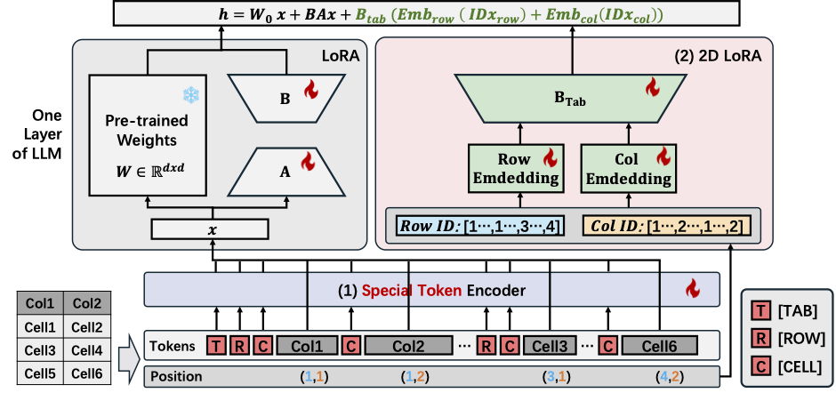

# TableLoRA: Low-rank Adaptation on Table Structure Understanding for Large Language Models

<p align="center">
  <a href="https://arxiv.org/abs/2503.04396">
    
  </a>
</p>

<div align="center">
  
</div>

Tabular data are crucial in many fields and their understanding by large language models (LLMs) under high parameter efficiency paradigm is important. However, directly applying parameter-efficient fine-tuning (PEFT) techniques to tabular tasks presents significant challenges, particularly in terms of better table serialization and the representation of twodimensional structured information within a one-dimensional sequence. To address this, we propose TableLoRA, a module designed to improve LLMs’ understanding of table structure during PEFT. It incorporates special tokens for serializing tables with special token encoder and uses 2D LoRA to encode low-rank information on cell positions. Experiments on four tabular-related datasets demonstrate that TableLoRA consistently outperforms vanilla LoRA and surpasses various table encoding methods tested in control experiments. These findings reveal that TableLoRA, as a tablespecific LoRA, enhances the ability of LLMs to process tabular data effectively, especially in low-parameter settings, demonstrating its potential as a robust solution for handling tablerelated tasks.

## Quick Start

Our implementation builds upon the [Llama Factory](https://github.com/hiyouga/LLaMA-Factory/tree/main) framework with the following key modifications:

1. **Data Preprocessing**:  
  - Added special tokens to input data before training in Llama Factory.  
  - Use code from the [`table_preprocess`](table_preprocess/) directory.
    ```shell
    python table_preprocess.py --dataset_name <dataset_name> --prompt_tuning True
    ```

2. **Table LoRA Data Processing**:  
  - Modified table_lora processing to recognize special tokens and include `position_id` as model input.   
  - Replace corresponding functions in `src/llamafactory/data/` with our implementations in the [`data`](data/) folder.

3. **Table LoRA Integration**:  
  - Extended PEFT to support table LoRA.
  - Add code from our [`table_lora`](table_lora/) directory to `src/llamafactory/`. 
  - Initialize with this code at entry points:  
    ```python
    from table_lora.table_lora import load_table_lora 
    load_table_lora()
    ```

After implementing these changes, you can train table LoRA using the modified Llama Factory framework.

## Adapter loading security

After `load_table_lora()` installs the TableLoRA PEFT methods, `from_pretrained`
loads only the root adapter by default. It no longer discovers all local or Hub
subdirectories, and invalid requested configurations are not silently skipped.
An explicitly requested `subfolder` loads only that folder:

```python
model = PeftModel.from_pretrained(
  base_model,
  "path/to/checkpoint",
  adapter_name="table",
  subfolder="table_adapter",
)
```

For multiple adapters, supply an explicit name-to-subfolder mapping. Include the
active `adapter_name` (default: `default`); use `None` for root weights:

```python
model = PeftModel.from_pretrained(
  base_model,
  "path/to/checkpoint",
  adapter_subfolders={"default": None, "row": "row_adapter", "column": "column_adapter"},
)
```

The same safety boundary applies to direct `load_adapter` calls. A string adapter
name loads root weights unless `subfolder` is explicit. An explicit list of names
uses those names as subfolders (`default` means root), or accepts an exact
`adapter_subfolders` mapping. No unrequested sibling directories are loaded.
Adapter names are bounded ASCII identifiers; subfolders must be relative paths
without traversal. At most 32 adapters can be selected in one call.

All selected weights must be `adapter_model.safetensors`. We read bounded regular
file bytes and decode them directly with `safetensors.torch.load`; PEFT's generic
weight loader and its pickle-based `adapter_model.bin` fallback are not used.
Missing or invalid safetensors files fail closed, including files containing
pickle data renamed to `.safetensors`. `use_safetensors=False`, remote adapter
code, and nested X-LoRA adapter loading are rejected. Existing `.bin` checkpoints
must be re-exported as safetensors by a trusted producer; renaming them does not
convert them. Do not deserialize an untrusted pickle to convert it.

Local selected weights must resolve within the chosen model directory. POSIX
loading walks canonical local paths through no-follow directory descriptors;
Windows loading verifies the actual opened file handle path before reading bytes.
This prevents a parent-directory swap from redirecting a validated local weight
read outside the chosen model. Other platforms without either capability fail
closed. Hub
downloads request only the selected safetensors file and preserve supported
revision/cache/authentication options and normal Hub cache symlinks. Prefer
reviewed immutable revisions. Each adapter file is limited to 512 MiB; this is
not a bound on total CPU/GPU memory consumption. Use maintained PEFT, PyTorch,
safetensors, and Hub dependencies, and do not enable unrelated remote model code
for untrusted inputs. These protections apply to TableLoRA adapter loading, not
to arbitrary base-model loaders elsewhere in Llama Factory.

### Security regression tests

```sh
python -B -m unittest discover -s tests -v
```

The standard-library tests run the actual `from_pretrained` and `load_adapter`
method bodies with controlled PEFT configuration and model/state-dict doubles,
covering explicit selection, no discovery, no silent config skip, and no generic
pickle fallback. Native format tests additionally require NumPy and safetensors;
they exercise the real safetensors codec through the NumPy binding in place of
the PyTorch binding. POSIX FIFO checks run on Linux. By default these tests do not import
the entire model stack, contact the Hub, perform GPU inference, or certify full
PEFT/Llama Factory version compatibility. A deterministic parent-directory swap
regression also exercises the POSIX and Windows local-file boundaries.
Validate training/inference with your
supported model stack before deployment and request a security rescan before
closing the associated finding.

An additional opt-in reference-stack smoke suite uses real PyTorch, PEFT, and
Transformers with randomly initialized tiny GPT-2 models and locally exported
TableLoRA safetensors adapters. It covers default and generic PEFT factories,
explicit multiple adapters, renamed/subfolder adapters, subsequent direct
`load_adapter` calls, exact restored adapter tensors, and pickle-only rejection.
`torch.load` is disabled during the loading checks. Each case runs in a separate
offline subprocess because TableLoRA patches PEFT process-wide:

```sh
TABLELORA_TEST_REAL_PEFT=1 python -B -m unittest discover -s tests -v
```

The tested reference stack is CPU PyTorch 2.5.1, PEFT 0.13.2, Transformers 4.45.2,
Accelerate 1.0.1, and safetensors 0.8.0 on Python 3.11/Linux. These are recorded
test versions, not a recommended deployment dependency lockfile. The smoke suite
does not download pretrained models, run GPU inference, or validate complete
training/Llama Factory workflows or all dependency versions. Maintain current
security patches in the deployment stack and validate its supported workflows.

## Citation
If you find this repository useful, please considering giving ⭐ or citing:
```
@inproceedings{he2025tablelora,
    title = "{T}able{L}o{RA}: Low-rank Adaptation on Table Structure Understanding for Large Language Models",
    author = "He, Xinyi  and
      Liu, Yihao  and
      Zhou, Mengyu  and
      He, Yeye  and
      Dong, Haoyu  and
      Han, Shi  and
      Yuan, Zejian  and
      Zhang, Dongmei",
    editor = "Che, Wanxiang  and
      Nabende, Joyce  and
      Shutova, Ekaterina  and
      Pilehvar, Mohammad Taher",
    booktitle = "Proceedings of the 63rd Annual Meeting of the Association for Computational Linguistics (Volume 1: Long Papers)",
    month = jul,
    year = "2025",
    address = "Vienna, Austria",
    publisher = "Association for Computational Linguistics",
    url = "https://aclanthology.org/2025.acl-long.1090/",
    pages = "22376--22391",
    ISBN = "979-8-89176-251-0",
}
```

## Contributing

This project welcomes contributions and suggestions.  Most contributions require you to agree to a
Contributor License Agreement (CLA) declaring that you have the right to, and actually do, grant us
the rights to use your contribution. For details, visit https://cla.opensource.microsoft.com.

When you submit a pull request, a CLA bot will automatically determine whether you need to provide
a CLA and decorate the PR appropriately (e.g., status check, comment). Simply follow the instructions
provided by the bot. You will only need to do this once across all repos using our CLA.

This project has adopted the [Microsoft Open Source Code of Conduct](https://opensource.microsoft.com/codeofconduct/).
For more information see the [Code of Conduct FAQ](https://opensource.microsoft.com/codeofconduct/faq/) or
contact [opencode@microsoft.com](mailto:opencode@microsoft.com) with any additional questions or comments.

## Trademarks

This project may contain trademarks or logos for projects, products, or services. Authorized use of Microsoft 
trademarks or logos is subject to and must follow 
[Microsoft's Trademark & Brand Guidelines](https://www.microsoft.com/en-us/legal/intellectualproperty/trademarks/usage/general).
Use of Microsoft trademarks or logos in modified versions of this project must not cause confusion or imply Microsoft sponsorship.
Any use of third-party trademarks or logos are subject to those third-party's policies.